# 🚀 Node.js Dockerized Task Management Application

A full-stack Task Management application built with **React, Node.js, Express, and PostgreSQL**, containerized using Docker and deployed on **AWS ECS Fargate**.

This project demonstrates practical implementation of containerization, REST API development, database integration, CI/CD automation, automated testing, cloud deployment, monitoring, and alerting.

---

## 📌 Project Overview

The application allows users to register, log in, and manage their tasks through a web-based dashboard.

The project goes beyond basic application development by implementing DevOps practices to automate builds, deploy containerized services, monitor application health, and detect backend failures.

## 🎯 Key Features

### Application Features
- User Registration and Authentication
- User Login
- Task Creation
- View All Tasks
- Update Task Details
- Manage Task Status
- Task Management Dashboard
- PostgreSQL Database Integration

### DevOps Features
- Docker Containerization
- Docker Compose
- Jenkins CI/CD Pipeline
- GitHub Webhook Integration
- Automated API Testing
- AWS ECS Fargate Deployment
- Amazon ECR Image Management
- Amazon RDS PostgreSQL
- Prometheus Monitoring
- Grafana Dashboards
- Email Alerting

---

## 🏗️ System Architecture

```text
                    Users
                      |
                      v
              React Frontend
                      |
                      v
             Node.js REST API
                 (Express)
                      |
                      v
              PostgreSQL DB


             CI/CD Pipeline
                      |
                 GitHub
                      |
                Webhook
                      |
                  Jenkins
                      |
              Automated Tests
                      |
               Docker Build
                      |
                 Amazon ECR
                      |
             Amazon ECS Fargate
                      |
             CloudWatch Logs


              Monitoring Stack
                      |
                  Prometheus
                      |
                   Grafana
                      |
                Email Alerts
```

---

## 🛠️ Technologies Used

| Category | Technologies |
|---|---|
| Frontend | React, JavaScript, HTML, CSS |
| Backend | Node.js, Express.js |
| Database | PostgreSQL |
| Containerization | Docker, Docker Compose |
| CI/CD | Jenkins, GitHub Actions, GitHub Webhooks |
| Cloud | AWS |
| Container Registry | Amazon ECR |
| Container Orchestration | Amazon ECS Fargate |
| Database Hosting | Amazon RDS |
| Logging | Amazon CloudWatch |
| Monitoring | Prometheus |
| Visualization | Grafana |
| Testing | Automated API Tests |
| Version Control | Git, GitHub |

---

## 🐳 Docker Containerization

Docker is used to package the application components into containers.

The project uses:
- Backend Docker container
- Frontend Docker container
- PostgreSQL database container

Docker Compose is used to manage the local multi-container environment.

### Docker Commands

Build images:

```bash
docker compose build
```

Start services:

```bash
docker compose up -d
```

View running containers:

```bash
docker ps
```

View logs:

```bash
docker compose logs
```

Stop services:

```bash
docker compose down
```

---

## 🔄 CI/CD Pipeline – Jenkins

A Jenkins pipeline automates the application build and verification process.

### Pipeline Workflow

1. GitHub source code checkout
2. Project file verification
3. Backend build
4. Frontend build
5. Automated verification

GitHub webhook integration triggers the Jenkins pipeline when changes are pushed to the repository.

### GitHub Actions CI Workflow

A separate GitHub Actions workflow runs automatically on pushes and pull requests to the `main` branch.

The workflow:
- Sets up Node.js 20.
- Starts a PostgreSQL 16 test database.
- Installs dependencies using `npm ci`.
- Initializes the test database.
- Runs automated API tests using `npm test`.


---

## 🧪 Automated Testing

Automated API tests are implemented to verify backend functionality.

The test suite successfully passed **9 API tests** during project verification.

Testing helps identify application defects and verify expected API behavior.

---

## 📊 Monitoring and Observability

Prometheus and Grafana are integrated to monitor application health and visualize metrics.

### Prometheus
- Collects application metrics.
- Monitors backend availability.
- Tracks Prometheus target health.

### Grafana
- Provides a monitoring dashboard.
- Visualizes backend monitoring information.
- Displays backend failure alert states.

### Email Alerting
Email notifications are configured through Grafana alerting.

The monitoring implementation was tested by simulating backend downtime and verifying that the alert entered the firing state and an email notification was received.

### Monitoring Screenshots

#### Grafana Dashboard

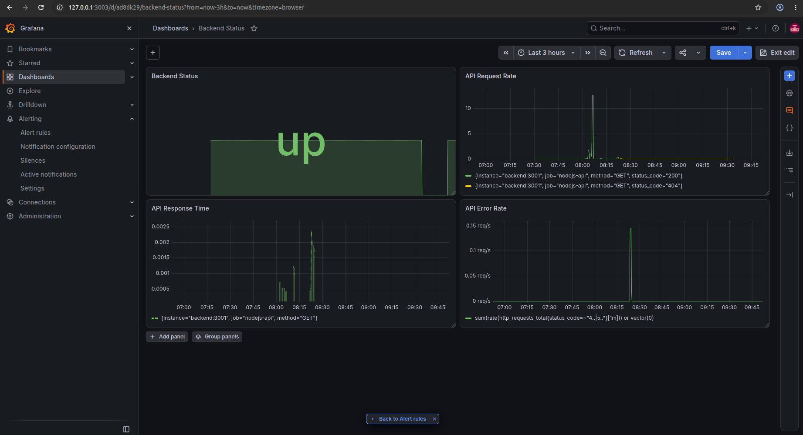

#### Prometheus Target – UP

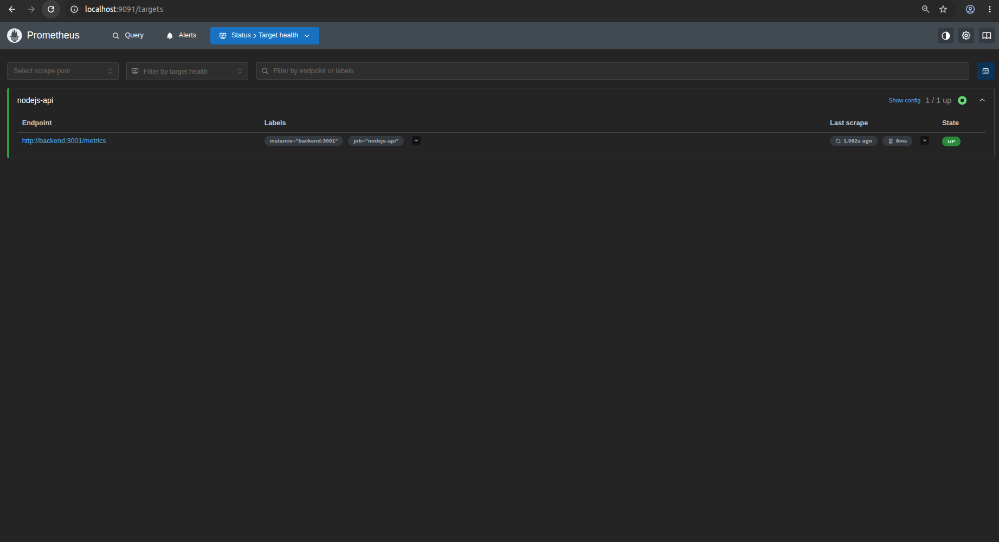

#### Prometheus Target – DOWN

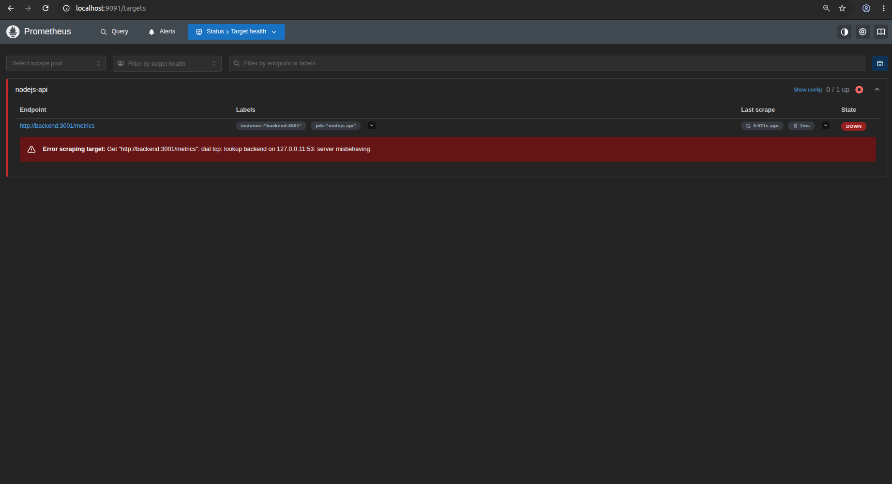

#### Grafana Backend Down Alert

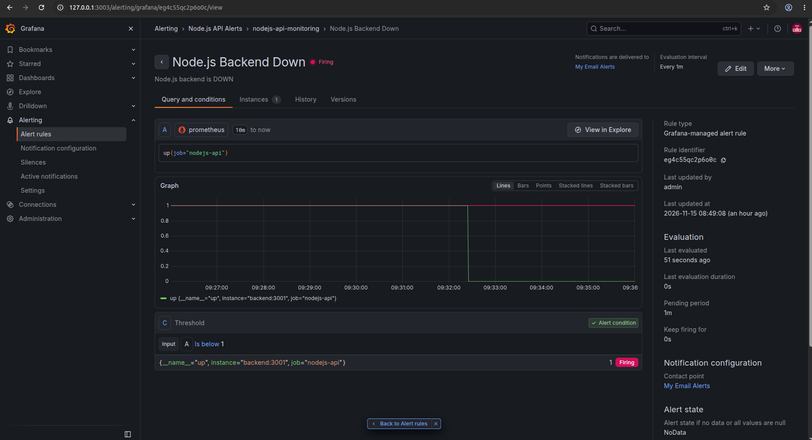

#### Email Alert Notification

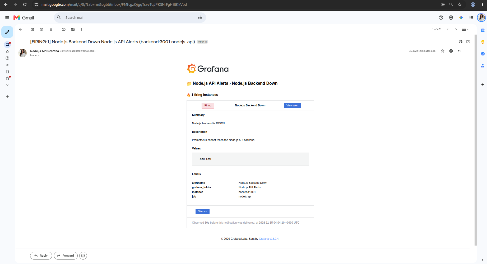

#### Email Configuration Test

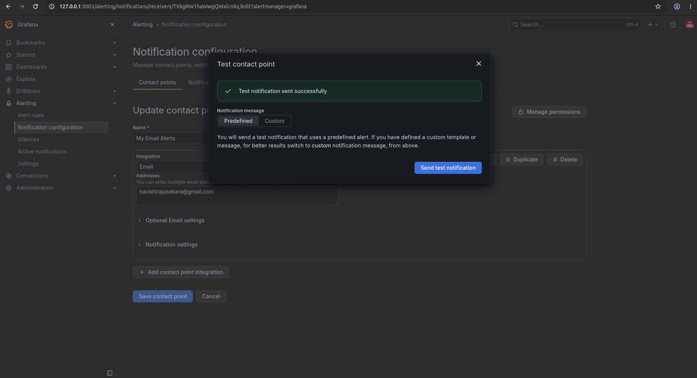

---

## ☁️ AWS Cloud Deployment

The application was deployed using AWS container and database services.

### AWS Services

| AWS Service | Purpose |
|---|---|
| Amazon ECS Fargate | Runs frontend and backend containers |
| Amazon ECR | Stores Docker images |
| Amazon RDS | Hosts PostgreSQL database |
| Amazon CloudWatch | Collects backend application logs |

### Deployment Architecture

```text
                  AWS Cloud
                      |
                Amazon ECS
                 (Fargate)
                      |
           -----------------------
           |                     |
           v                     v
      Frontend Service     Backend Service
           |                     |
           |                     |
           |                     v
           |                Amazon RDS
           |                PostgreSQL
           |
           v
      User Browser

      Amazon ECR
      Docker Images

      CloudWatch
      Application Logs
```

### AWS Deployment Screenshots

#### Application

**Login Page**

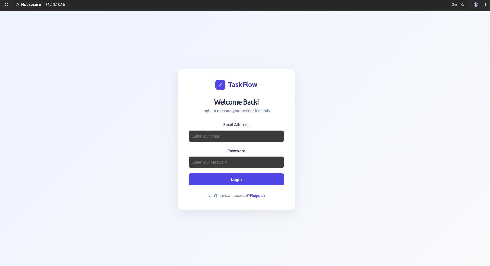

**Registration Page**

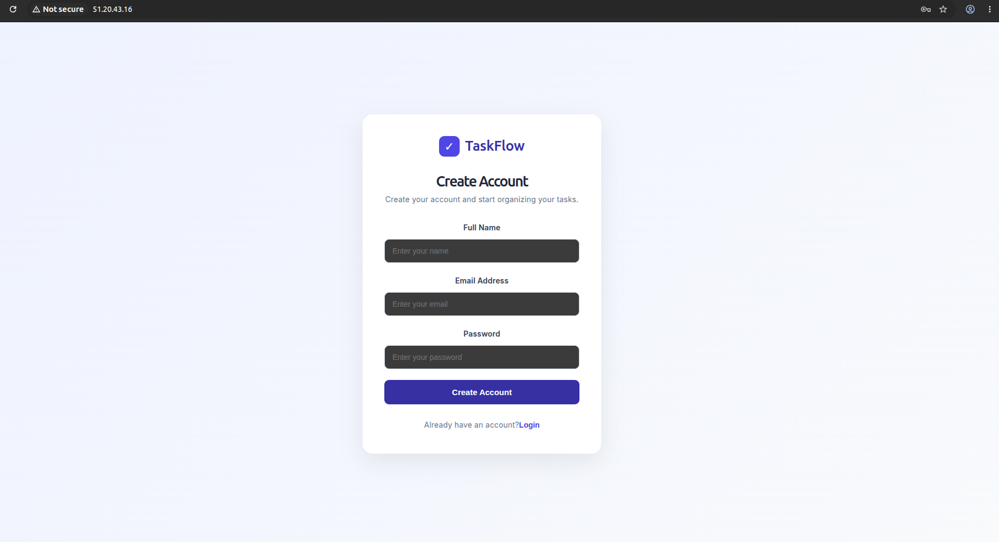

**Dashboard**

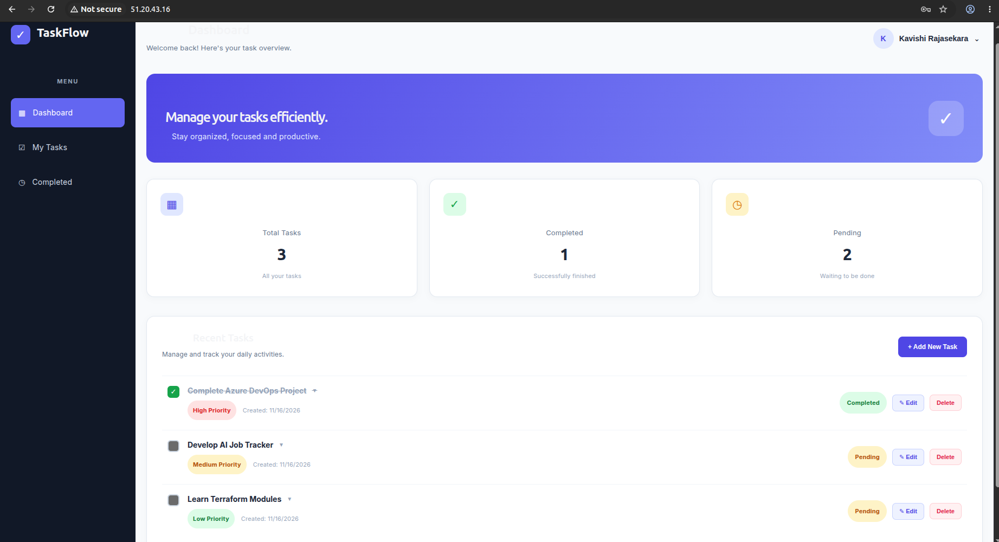

**Task Details**

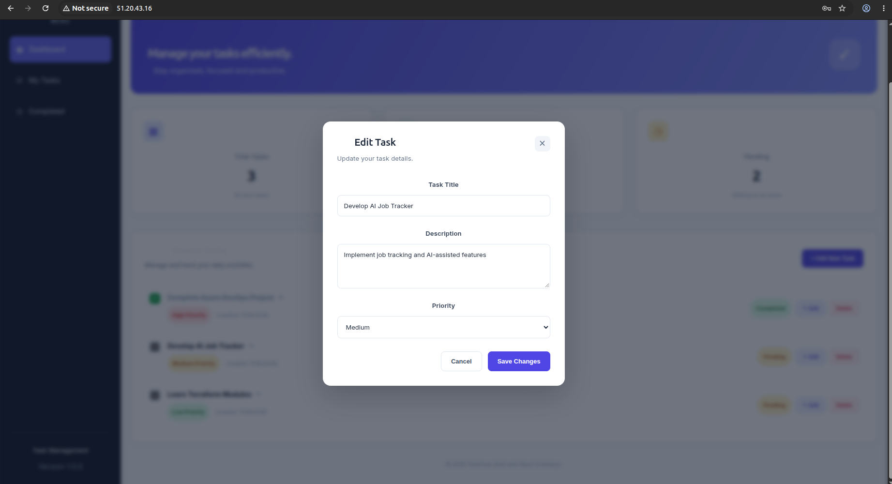

#### AWS Infrastructure

**ECS Backend Service**

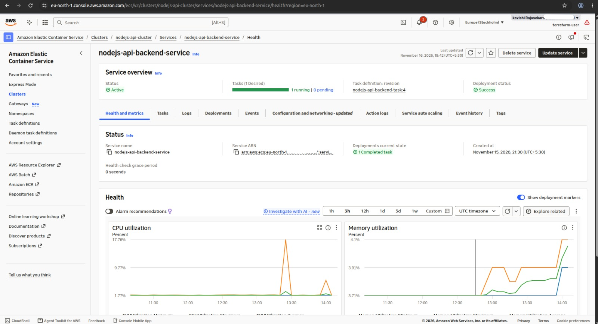

**ECS Frontend Service**

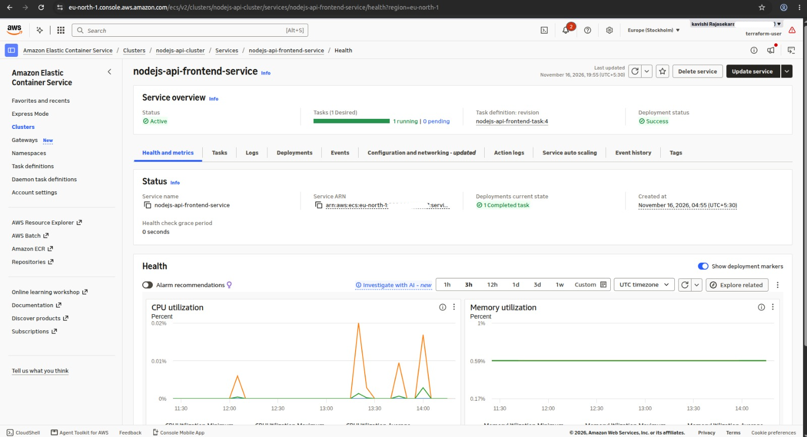

**RDS PostgreSQL Database**

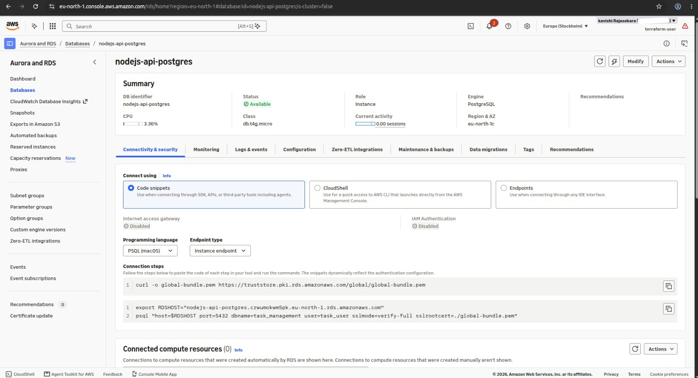

**ECR Repositories**

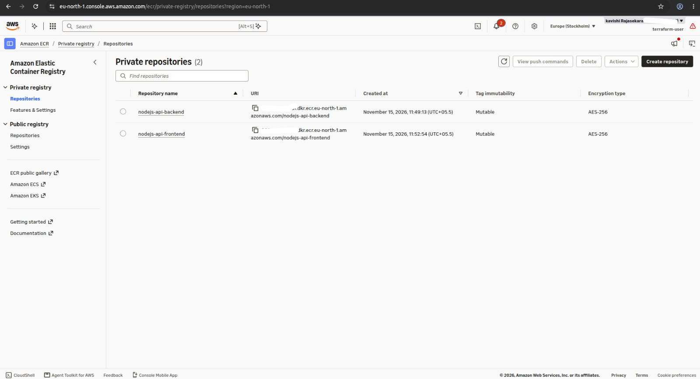

**CloudWatch Backend Logs**

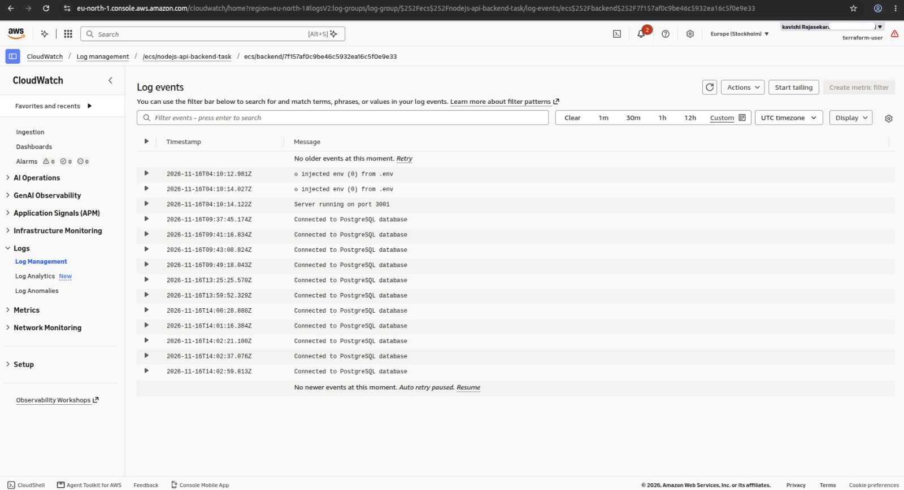

---

## 📂 Project Structure

```text
nodejs-dockerized-api/
├── src/
│   ├── config/
│   ├── controllers/
│   ├── middleware/
│   ├── routes/
│   ├── services/
│   └── validators/
├── frontend/
│   ├── public/
│   └── src/
├── database/
├── tests/
├── docs/
│   └── screenshots/
│       ├── aws/
│       └── monitoring/
├── monitoring/
│   └── prometheus/
├── Dockerfile
├── docker-compose.yml
├── Jenkinsfile
├── package.json
├── .gitignore
└── README.md
```

---

## 🔐 Security Considerations

- Database credentials are kept out of public documentation.
- AWS security groups restrict database access.
- Environment variables are used for sensitive configuration.
- Secrets and credentials should not be committed to GitHub.
- Production deployments should use HTTPS and appropriate access controls.

---

## 📚 Key DevOps Concepts Demonstrated

- Application Containerization
- Docker Image Management
- Multi-Container Application Deployment
- CI/CD Pipeline Automation
- GitHub Webhook Integration
- Automated Testing
- AWS Cloud Deployment
- Container Orchestration with ECS Fargate
- Managed Database Hosting
- Application Logging
- Metrics Collection
- Monitoring Dashboards
- Alerting and Failure Detection

---

## 🔗 Project Repository

[GitHub – Node.js Dockerized API](https://github.com/Hirunodhya2003/nodejs-dockerized-api)

---

## 👨‍💻 Author

**Kavishi Hirunodhya**

Cloud & DevOps Enthusiast | AWS | Docker | Jenkins | CI/CD | Prometheus | Grafana
